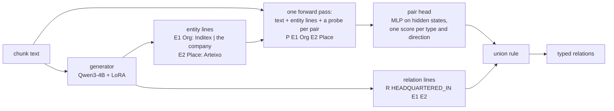

# Typed relation extraction from business text with a small language model and a pair classifier

*Whitepaper, version of 2026-10-16. The full experimental record (every run, setting and confidence interval) is in
lab notebooks kept in the development repository, which is not public; paths to scripts, data and notebooks in this
paper (`bench/`, `scripts/`, `data/`, `runs/`, `docs/findings-*`) refer to that repository. relweave is the published
code.*

## Abstract

We extract typed knowledge graphs from short passages of business text: entities with all their mentions, and
relations of 21 types such as ownership stakes, subsidiaries, acquisitions, executive roles and locations. The aim is
the smallest model that does this well. Starting from a fine-tuned Qwen3-1.7B that writes entities and relations as
text (typed relation F1 0.65), we reach 0.78 on held-out business Wikipedia text with a Qwen3-4B generator for entities
and a small pair-classification head on the model's hidden states for relations. The gains came from three moves: taking
the relation decision out of text generation and into a classifier, training that classifier on the same entity lists
it sees at run time, and a larger base model. Given the correct entities, the relation step scores 0.82-0.84, in the
range of the best published document-level systems; most of the remaining error now comes from entities, in particular
names made of ordinary words, type conventions and the grouping of related names. We also report a dozen measured
negative results and a labelling method that corrects the model's own drafts at a third of the cost of labelling from
scratch. Run as a user runs it, on whole documents (chunking and merging included), the system scores 0.751. For
relation types defined at run time, a yes/no question adapter reads each type's definition: 0.65-0.71 F1 end to end on
unseen types in four new domains, 0.56 on unseen Re-DocRED types (GLiREL 0.18), with a density adjustment that makes
one threshold serve short and dense text.

On real documents (government press releases, court opinions, news) scored against AI-made gold the same system looked
far weaker (0.54), but that gold proved narrow and partly wrong. Scored instead by pooled judging, where every relation
of the gold and of every system is checked against the text by two LLM judges (tested with planted decoys, 1-2%
accepted), the unchanged 4B system reaches judged F1 0.75 (95% interval 0.67-0.82) on documents unseen in training,
level with a single careful labelling pass by a frontier model; press releases (0.66) are its weakest genre. Its
remaining misses are mostly relations written inside the noun phrase before a name ("FBI Special Agent X",
"Republican senator X"). At the point of decision it gives a missed relation a start probability of about 0.19
against 0.70 for those it writes, and training on completed labels does not change that decision (Section 6).

## 1. Introduction

Business text states who owns what, who runs what and where companies operate, usually in dense sentences: "Inditex,
which owns Zara, Massimo Dutti and Pull&Bear, is based in Arteixo." Turning such text into a typed graph needs two
things: finding the entities, including every pronoun and description that refers to them ("the company", "it"), and
deciding for each pair of entities whether, and how, the text relates them.

Large language models can do both when prompted, but a small fine-tuned model is cheaper to run and easier to control.
The question this work explores is how small, and with which architecture. Our constraints shaped the answers: one
8 GB consumer GPU and a few dollars of rented compute per experiment, labels written by a frontier model rather than by
people, and a requirement that the model read relations from the text in front of it rather than recall facts about
well-known companies.

Contributions:

- A system that combines a small generative model for entities with a pair-classification head on that model's own
  hidden states for relations, joined by a simple union rule; 0.65 to 0.78 typed F1 (Sections 4-5).
- A decomposition of the remaining error into an entity part and a relation part, showing that with correct entities
  the relation step is at the level of published document-level systems (Section 5.4), and an analysis of what the
  entity step gets wrong (Section 6).
- A record of what did not work, with our reading of why (Section 7), and a cheap labelling method (Section 3.3).

## 2. Related work

**Document-level relation extraction.** DocRED [Yao et al. 2019] and its re-annotated version Re-DocRED [Tan et al.
2022] are the standard benchmarks. The strongest systems are encoder classifiers over entity pairs: ATLOP introduced an
adaptive threshold class and pair-specific pooling of the context [Zhou et al. 2021]; DREEAM adds supervision of that
pooling with evidence sentences [Ma et al. 2023]; KD-DocRE and DocuNet let pairs interact through attention over the
entity-pair grid [Tan et al. 2022b; Zhang et al. 2021]. With entities given, these reach about 0.80 F1 on Re-DocRED at
355M parameters. Re-DocRED also showed that the original DocRED labels missed many true relations and that
re-annotation alone raised scores by about 13 F1, a reminder that label completeness bounds measured quality.

**Large language models for relation extraction.** Fine-tuned 7-13B language models that generate relations as text
reach 45-55 F1 on Re-DocRED with entities given, well below encoder classifiers; placing a classifier in front of the
language model closes most of the gap [Li et al. 2024; Pi et al. 2025]. Packed levitated markers let one forward pass
score many entity pairs [Ye et al. 2022]; we use the same idea in a decoder.

**Known failure modes.** Coordinated lists ("A, B and C") are a long-standing source of missed facts: open information
extraction systems fail to split conjunctions in about a third of sentences [Schneider et al. 2017], and coordination
analysis was a main gain of OpenIE6 [Kolluru et al. 2020]. Language models lose track of items late in lists [Zhang et
al. 2026]. Relation extractors also predict relations from entity names rather than from the text, which counterfactual
analysis [Wang et al. 2022] and entity replacement [Wang et al. 2023] expose.

**Zero-shot schemas.** GLiNER encodes entity-type labels together with the text in a bidirectional encoder and matches
span and label representations by dot product, so new entity types need no retraining [Zaratiana et al. 2024]; GLiREL
does the same for relations between given entity pairs [Boylan et al. 2025]. GoLLIE instead fine-tunes Code-LLaMA to
follow annotation guidelines written as Python classes, with docstrings as definitions and comments as representative
candidates, and regularises against memorising names (class order shuffling, class dropout, guideline paraphrasing,
candidate sampling, class name masking); it gains 13 F1 on average zero-shot over a no-guideline baseline, and removing
the representative candidates costs the most (55.3 to 49.9) [Sainz et al. 2024]. Its zero-shot evaluation covers named
entities, events and event arguments; relation extraction is in its training data but not evaluated zero-shot. Our
pair-state . type-state scoring has the matching structure of GLiNER, and our authoring of the schema as classes with
docstring definitions follows GoLLIE; our evidence (Section 5.5) is for relations, which neither paper evaluates
zero-shot. Type diversity in training is the lever both point to.

## 3. Task, data and evaluation

### 3.1 Task and schema

Input is a chunk of about 1,000 characters of English business Wikipedia text. Output is a set of entities (Person, Org,
Place, Object, Event, Coordinate), each with every surface string that refers to it, and a set of relations of 21 types,
each legal only for certain endpoint types (for example OWNS_STAKE_IN: Person or Org to Org; BORN_IN: Person to Place).
The schema is written once in code; prompts, decoding grammars, label validation and scoring are all derived from it.

### 3.2 Data and splits

Labels were written by Claude Opus agents following a written convention (for example: a list states a relation for
every item when a lead sentence does; a person is LOCATED_IN a place only where they live). The training labels were
completed by a second pass after an audit showed the first pass missed relations, and the test labels were additionally
audited relation by relation.

| split | chunks | articles | labels |
|---|---|---|---|
| training | 2,859 + 500 list-rich chunks (Section 3.3) | 460 + 210 | completed (new chunks: corrected drafts) |
| validation | 208 | | completed |
| test | 105 | | completed and audited |
| fresh test | 64 | 13 | one pass; not tuned on, later used for size and serving comparisons |

Evaluation text shares no facts with training text, not just no documents: training articles that name three or more
evaluation people or companies, or the subject of an evaluation article, are excluded, and candidate test articles are
checked for relations already present in training. All decisions (thresholds, model choices) are made on validation;
test is reported, never tuned on.

### 3.3 Labelling at lower cost

Labelling from scratch cost about 4,000-6,000 agent tokens per chunk. Two cheaper routes were measured:

- **Structured knowledge as candidates.** Wikipedia links identify 56% of gold entities, but Wikidata facts cover only
  11-12% of gold relations: Wikidata records what is true, while our labels record what a passage states (stakes,
  markets, executive roles), so the distant-supervision assumption [Mintz et al. 2009] fails at the passage level.
- **Correcting the model's drafts.** The current system drafts each chunk; an agent reads the schema once and returns
  only corrections (drop, retype, add). On list-rich text this costs 1,940 tokens per chunk against 6,100 from scratch,
  and agrees with independent from-scratch labels at 0.876 typed F1 on ordinary chunks (0.803 on dense list chunks;
  two independent from-scratch passes agree at about 0.88). The risk is anchoring: correctors kept some borderline draft
  relations a from-scratch labeller would not write. Re-DocRED was built with the same propose-then-verify pattern.

An audit of the labels themselves found no sign of the list-position problem reported for language models: in
enumerations, the last item is labelled as often as the first.

### 3.4 Metric and significance

Typed relation F1, strict: a predicted relation counts only if both endpoints align to gold entities (by mention-span
overlap and type) and the type and direction match. Two independent labelling passes agree at about 0.88, which we
treat as the ceiling; an audit found about 8% of the model's "invented" relations to be true, so gold is incomplete.
The test set has 105 chunks, so a single score is uncertain by about ±0.045; differences between systems are judged by
a paired bootstrap over chunks, mostly on validation.

## 4. System

**Generator.** Qwen3-4B [Qwen Team 2025] with a LoRA adapter [Hu et al. 2021] trained on a 4-bit base [Dettmers et al.
2023]. It writes a compact line format rather than JSON: entity lines with all surface strings, then relation lines
grouped by sentence. Decoding is constrained by a grammar generated from the schema (XGrammar [Dong et al. 2024]), so
every output parses and every relation is legal for its endpoint types.

**Pair head.** After the generated entity lines, one short probe line per entity pair is appended, and all probes are
packed into a single forward pass with an attention mask that lets each probe see the text and the entity lines but not
the other probes (levitated markers [Ye et al. 2022]). The hidden states at the end of each probe, from two layers, feed
a small classifier (about 2M parameters) with one score per relation type and direction plus a "no relation" threshold
score, trained with the adaptive-threshold loss of ATLOP [Zhou et al. 2021]. The probes are needed because the model
reads left to right: a probe placed after the text and the entity lists is the first position that has seen
everything relevant to both entities.

**Training.** The head is first trained on a frozen model, then jointly with a second LoRA adapter, with an auxiliary
language-model loss on the entity lines (the recipe of Radford et al. [2018]). Half of the training examples use the
gold entity lists and half the generator's own lists for the same chunks, aligned to gold; the latter matters, because
the head reads the generator's lists at run time (Section 5.3).

**Union.** A generated relation is kept unless the head rejects it firmly, and every relation the head accepts above a
margin is added; both cut-offs are chosen on validation. This is a hand-tuned ensemble rule; its parts are standard.

## 5. Experiments

### 5.1 Setup

Training ran on one RTX 3070 Ti (8 GB) and on rented L4 GPUs (24 GB; jobs of one to six hours). Base models are
Qwen3-1.7B and Qwen3-4B in 4-bit with LoRA rank 32. The pair head is trained with up to 200 probes per chunk; the 8 GB
card fits only 80, which measurably hurts (Section 7).

### 5.2 Main results

| system | test F1 | validation F1 |
|---|---|---|
| 1.7B generator, all real data | 0.650 | 0.614 |
| 1.7B generator + verifier (a second adapter judging each generated pair) | 0.688 | |
| 1.7B generator + 1.7B pair head, union | 0.716 | 0.718 |
| 4B generator alone | 0.684 | 0.650 |
| 4B generator + 4B pair head, union | 0.759 | 0.754 |
| + head trained on the generator's own entity lists, 200 probes | 0.773 | 0.778 |
| **+ 500 list-rich chunks of new labels (current best)** | **0.783** | **0.781** |

On the fresh test set (13 documents, one labelling pass) the system before the last two steps scored 0.751. The exclusion was not complete: 75 of 532 person and company names in the test set (64 of 306 in the fresh test) also occur in training labels, and 10 (24) relation triples recur by name; the fresh test overlaps training on Heineken and Bouygues (review of 2026-10-08).

### 5.3 What each step contributed

- **Classifier instead of generation for relations.** The pair head adds about 0.07-0.10 over its generator at every model
  size, and removes most invented relations (340 to 161 on test), in particular relations between distant entities that
  reflect world knowledge rather than the text (46 to 3).
- **Joint training.** A head on a frozen model barely helps (0.667 on test for the 4B); training the adapter together
  with the head is what makes the hidden states useful for pair decisions (0.759).
- **Matching training to run time.** Training the head on another model's entity lists and capping probes at 80 cost
  0.024 on validation (95% interval +0.015 to +0.034).
- **Model size.** Qwen3-4B over Qwen3-1.7B: +0.05 to +0.07 at equal data, about +0.04 for the full system; most of the
  4B's advantage is in the entity lists rather than in the relation decisions.
  With the full recipe the 1.7B system scores 0.732 against 0.780 over 377 held-out chunks (-0.048, 95% interval
  -0.067 to -0.030); it is published as relweave-1.7b-base.
- **Serving.** An adapter trained on the 4-bit base learns corrections for its rounding: on the original full-precision
  base it loses about 0.03 generator F1. Dequantizing the 4-bit base and merging the adapter reproduces the trained
  model as a plain bf16 model, which vLLM serves at about 9x (4B, fp8 weights) to 16x (1.7B) the throughput of the
  transformers backend on one 8 GB GPU, at the same system F1 (4B 0.771 vs 0.770, 1.7B 0.749 vs 0.736, 64 chunks).
- **More labels.** 2.6 times more labelled text gave +0.04 early on; 500 further list-rich chunks gave +0.003 on
  validation (not significant): the learning curve has flattened for the relation step.

### 5.4 The relation step with correct entities

To separate the two halves of the task, the same pair head was given the gold entity lists instead of the generator's.
It scores **0.839 on validation and 0.822 on test** (precision 0.855, recall 0.793), against 0.781 and 0.783 end to end.
Two conclusions: the relation step itself is in the range of the best published
systems evaluated the same way (DREEAM 0.807 on Re-DocRED with entities given [Ma et al. 2023]; different data, so
indicative only), and the gap to the end-to-end score is only partly entity finding (Section 6).

### 5.5 Changeable schema: reading relation definitions

**Problem.** A user supplies their own relation types, each with a definition, and the system should follow them without
retraining. The relation types are authored as Python classes (`bench/ontology/`: an `Entity` subclass per entity type,
`Relation[Source, Target]` per relation type, the docstring being the definition; `bench/ontology/business.py` holds our
21 types and `bench/schema.py` is derived from it). The generator reads such a schema from its prompt, but the pair head
ends in one output unit per (type, direction) and cannot.

**The conditioned head.** Each relation type gets a probe line packed into the same forward pass as the pair probes,
"T R<random code>: <source types> -> <target types>. <definition>"; the code is random per type and chunk, so only the
definition carries meaning, not the name or position. The score is f(pair state) . (g(type state) + direction vector)
against a learned threshold vector, with f and g small projections, trained with the same threshold loss over a variable
label set. This is the matching structure of GLiNER and GLiREL (Section 2), applied to the hidden states of the 4B model.

**Protocol.** Three types are held out entirely: MEMBER_OF, FAMILY_OF and OWNS_STAKE_IN get no probe, and pairs of only
held-out types are left out of the loss. The decision margin is chosen on trained types only, so held-out types see a
threshold they never influenced. Validation, gold entities, full schema, frozen states of the current head's LoRA
(L4 run, 18 trained types):

| | fixed head | description-conditioned head |
|---|---|---|
| 18 trained types | 0.819 | 0.799 |
| 3 held-out types (zero-shot) | 0.000 | 0.189 |
| MEMBER_OF (12 gold) | 0 | 0.727 |
| OWNS_STAKE_IN (171) | 0 | 0.160 |
| FAMILY_OF (31) | 0 | 0.000 |

A type never trained on is extracted from its definition alone (MEMBER_OF 0.73), at a cost of 0.02 on trained types.
Transfer is uneven: OWNS_STAKE_IN competes with trained neighbours (SUBSIDIARY_OF, ACQUIRED), and FAMILY_OF has no
trained person-person type to learn from. The next step adds Re-DocRED's 89 relation types as extra conditioning data,
each with its Wikidata label and description and three plain-English definitions (drawn per document). "Strict" leaves out
the Re-DocRED types closest to the held-out ones (member of, member of political party, member of sports team; father,
mother, spouse, child, sibling; owned by). 912 of 1,500 documents were kept (the rest did not fit in 8 GB with 96 type
probes packed in one pass). The decision number is the pooled held-out F1, with a paired bootstrap over chunks against the
head trained on our types only:

| conditioned head trained on | trained types F1 | held-out pooled F1 | vs ours only | MEMBER_OF (12) | FAMILY_OF (31) | OWNS_STAKE_IN (171) |
|---|---|---|---|---|---|---|
| fixed head (reference) | 0.813 | 0 | | | | |
| our 18 types | 0.771 | 0.125 | | 0.762 | 0.000 | 0.074 |
| + Re-DocRED strict (80 types) | 0.799 | 0.287 | +0.162 [+0.070, +0.250] | 0.250 | 0.061 | 0.314 |
| + Re-DocRED all (89 types) | 0.797 | 0.145 | +0.020 [-0.075, +0.126] | 0.600 | 0.324 | 0.063 |

More described types help, significantly in the strict setting, and they also lift the trained types (0.771 to 0.799).

**What this does and does not show.** The mechanism works, but 0.29 zero-shot against about 0.80 for trained types is not
yet a usable schema change. The held-out numbers are unstable: the same setup scored 0.189 in the first run and 0.125 in
the second (the margin, picked on trained types, moved from 1.0 to 0.0), and per-type counts are small (12 MEMBER_OF).
With all Re-DocRED types FAMILY_OF rises (spouse, child and sibling are seen) while OWNS_STAKE_IN falls (Re-DocRED's
"owned by" runs owned to owner, the reverse of ours). An unseen type's scores are not calibrated to the shared threshold;
per-type calibration is part of the problem. We therefore decide on pooled held-out F1 with a paired bootstrap, not on
single types.

### 5.6 Zero-shot relation types: asking the model

**Method.** Instead of a head matching pair states to definition states (Section 5.5), the model is asked. For a
passage, its entity lines and an instruction, every candidate (source, target, relation definition) becomes one short
question, "Q: Source: X | Target: Y | Relation: <definition> A:", and the probability of " yes" against " no" at its
last token is the score. All questions of a passage are packed into one sequence after the shared prefix; each attends
to the prefix and to itself only, with positions continuing from the prefix, so a passage with a thousand questions
costs a few forward passes. A fresh LoRA (rank 16) on the 4-bit Qwen3-4B is trained one epoch with cross-entropy on the
answer token: 1,693 passages (600 Re-DocRED training documents, 600 business chunks, open-type passages labelled by a
language model), about 80,000 questions, gold triples plus negatives (the same pair with another fitting type, the
reversed direction, random fitting pairs). Fifteen Re-DocRED types (director, composer, author, performer, record label,
located in or next to body of water, mouth of the watercourse, league, platform, developer, publisher, present in work,
cast member, religion, official language) and their near neighbours (member of, father, mother, spouse, child, sibling,
owned by, ...) never appear in training, nor do three business types. Asked without training, the model finds 73% of
unseen relations at 9% precision: the knowledge is there and the calibration is not.

**Benchmarks.** (1) Re-DocRED dev, the 15 held-out types, endpoint gating with Re-DocRED's original entity types,
threshold chosen on documents 50-150 and F1 on 150-300. (2) Near types from our business gold, where attributes split
coarse types into siblings (CEO / chair / vice chair / board member; parent / spouse / sibling). (3) A synthetic set
(published as relweave-zeroshot-eval): 12 types in 4 sibling sets that occur in no training data, 100 short and 50 dense
fictional passages with planted gold and near misses; a blind second labelling agreed at 0.989 F1. (4) Four new domains
end to end (charity, sport, research, regulation; 13 more unseen types, 32 news-style passages, a blind second
labelling agreeing on all 149 relations), run through relweave as a user would: generator entities, chunking, merge.

| benchmark | F1 |
|---|---|
| GLiREL on Re-DocRED (15 unseen types) | 0.180 |
| untrained Qwen3-4B asked the same questions | 0.152 |
| Re-DocRED, one threshold / per-type thresholds | 0.497 / 0.561 |
| near types (business): family / roles / ownership / place / employment | 0.69 / 0.44 / 0.61 / 0.65 / 0.56 |
| synthetic short / dense, gold entities, threshold tuned on the other half | 0.82 / 0.74 |
| new domains end to end, default calibration, small / large schema | 0.71 / 0.65 |

An audit of the 257 false positives on Re-DocRED by blind LLM judges, controlled with known-true and known-false items
(none of 40 known-false accepted), found about a third stated in the text but missing from the gold, and only 57% of the
gold itself stated in the text (the rest is world knowledge); the official 0.50-0.56 understates how well the model
reads. Near siblings are kept apart: on the synthetic sets the highest-scoring type of a pair's sibling set is the gold
one 96-98% of the time and reversed directions almost never pass.

**The threshold.** Every number above with a tuned threshold used labelled examples of the tested types, which a user
with new types does not have. The best raw threshold rises with entity density (about 0.7 for short passages, about 0.9
for dense ones and Re-DocRED), because each additional pair is another chance for a false yes; a fixed 0.5 gives 0.77
short and 0.57 dense. relweave therefore adjusts each score for the number n of pairs its type is asked on in the chunk,
logit(p) - 0.5 ln(n / 5), and compares it with one threshold (0.6). Fitted on the synthetic sets, this reached 0.84 and
0.73 there (best fixed thresholds 0.83 and 0.74) and 0.47 on held-out Re-DocRED (best fixed 0.51); on the new domains it
lands within 0.03 of the best threshold. Counting all questions instead of pairs per type scores the same but makes a
type stricter whenever the schema grows. Batch Calibration [Zhou et al. 2024], centring each type's log-odds per
document, hurt (0.36 on Re-DocRED): it removes the absolute "this type is absent here" signal.

**Formats and size.** Multiple choice per pair, all candidate types plus "none of these" in one question as in QA4RE
[Zhang et al. 2023], was tried on Qwen3-1.7B against yes/no on the same data: better on Re-DocRED (0.41 vs 0.31) with a
threshold that transfers across benchmarks, but worse on the synthetic set (0.61 vs 0.73), where it predicted the
reverse of 18% of directed gold triples; asking both directions in one question removed the direction errors and lost
the Re-DocRED gain. Yes/no stays. Zero-shot depends on size more than fixed types do: on Re-DocRED the 1.7B reaches 0.31
against 0.50 for the 4B with yes/no.

**Where it fails** (new domains, large schema, 111 right): missed with a low score 29 (relations stated indirectly), the
two entities found only in different chunks 9, invented on an unrelated pair 29, on an entity not in the gold 23
(mostly descriptions in later chunks made their own entity), near type 21 (donated / sponsors, inspected / fined).
Research types are weakest (0.46-0.51). The passages are model-written and unambiguous (two labellers agreed on every
relation), so real text is likely harder.

### 5.7 Beyond Wikipedia: real, long and messy documents

The system was trained on Wikipedia company articles. To see how far that carries, we built three further test sets,
all scored per document with strict name matching and a document-bootstrap 95% interval:

- *Real documents* (20): DOJ press releases and Wikinews politics, science and sport, each labelled by two independent
  agent passes; gold is what both passes have, plus disputed relations and every model false relation that a third
  pass confirmed against the text (pooled adjudication). Each pass scored against this gold reaches only 0.66 and
  0.74, which bounds what the gold can show.
- *Long back-reference documents* (32): synthetic multi-paragraph business stories in which entities are named once
  and then called "the company" or "she".
- *Messy copies* of the real documents: PDF-style hard wraps and hyphenation, page headers, web boilerplate and
  entities, run-together paragraphs, cleaned by a rule-based tidy step before extraction.

| system (4B) | Wikipedia | real documents | long back-reference |
|---|---|---|---|
| as trained, 200-word chunks | 0.755 | 0.549 (0.43-0.68) | 0.472 |
| + relations of never-named entities left out | 0.755 | 0.549 | 0.566 |
| + coreference pre-pass (Maverick) | 0.732 | 0.564 | 0.748 |
| instead: 500-word chunks | 0.699 | 0.544 | 0.804 |

The long documents fail for a reason Wikipedia hides: 42% of their relations join entities never named in the same
chunk, and the per-chunk generator writes such a relation against a "the company" node the merge cannot link, so it
counts as both invented and missed. Leaving out relations of entities no chunk ever named removes those (false
relations 295 to 157, true ones unchanged), at the cost of true facts about things the text never names; it is a
switch. Rewriting pronouns and descriptions to names before chunking [Martinelli et al. 2024; Otmazgin et al. 2022]
fixes the cause: every chunk then names its entities. It costs 0.024 on Wikipedia (paired interval -0.053 to +0.003),
where entities are named often and each wrong rewrite still hurts; longer chunks fix the same problem but cost 0.05 on
Wikipedia. Training the generator on rewritten text gave no gain on the long or real documents (0.736, 0.541). Messy text after the tidy step costs about
0.03. Continuing the generator on 47 real documents, alone or mixed with the training data, did not beat the original
model on real documents (all differences inside the interval).

Real documents are mostly not long-context problems: only 19 of their 171 gold relations cross chunks. Their errors
are events (sport F1 0.31 against 0.66 for DOJ releases), organisation-unit levels in staff lists and role types. The
event errors trace to the training data: Event is 1.3% of training entities and PARTICIPATED_IN 681 relations against
8,547 for SUBSIDIARY_OF, and the compact prompt carries no type definitions, so the model files a cup final under Org
and the participants have nothing to attach to. The lesson is about data more than architecture: a model fine-tuned on
one genre learns that genre's label prior.

A controlled probe separates list length from list form: one-sentence chunks with N invented names, 6 per setting, run
through the full system. Plain coordinated lists, lists with bracketed roles, bulleted lists, grouped lists ("A and B
of X, and C of Y"), lists with descriptions between items and lists of places are recalled completely up to 15 items.
Two forms fail at length: lists in which every item carries its own relative clause ("founded by A, who later left, B,
who ...": 1.00 at 4 items, 0.48 at 10) and "respectively" pairings (0.88 at 4, 0.60 at 10). The list errors of Section
6 are therefore errors of sentence structure, not of list length or early stopping, and the probe names the forms that
training data must add. In the event pattern the model writes the event and every participation but shortens the name
("Kestrel Regional Cup" for "Kestrel Regional Cup final"), which strict matching counts as a miss.

Markdown tables, as Word and HTML tables dump to text, are read well once each row is its own sentence: in tables of 4
and 10 rows stating executives or subsidiaries' cities, relation recall is 1.00 and 0.97, against 0.87 for the
10-row city table when rows ran together with the surrounding text as one sentence. Rewriting each row as a sentence
with its column headers ("City: Lyon; Subsidiary: Zelland Textiles; Staff: 642.") made it worse (0.20 for the
10-row city table): the model reads the raw row better than the verbalised one.

A first attempt at broadening the training data failed instructively. Continuing the generator on 15 agent-written
documents of varied genres (each with events, a table and a hard list, weighted four times), 300 script-made hard
lists and a Wikipedia replay moved the list probe up (clause-per-item lists 0.75 to 0.83 at 10 items) but lowered
list recall in real text (Wikipedia enumerations 0.90 to 0.86) and real-document F1 (0.549 to 0.471). The model had
learned the writers' convention that trials, schemes and incidents are events, which the test labels did not share
(event false relations tripled), and lost true relations elsewhere. Training and test labels must follow one
convention, and a few heavily weighted documents shift the model more than they teach it.

### 5.8 Measuring and improving real-document extraction

**Scope.** The use case is people, organisations and places and how they relate. Events, objects and coordinates were
taken out of scope: event relations were a quarter of the real-document gold but half its misses, with free-text names
the labellers themselves disagreed on. They stay in the schema (nothing retrained) but are left out of every score
below, as are relations with an Object or Coordinate end.

**A frozen benchmark.** Real-document results so far rested on 20 documents that had been used for tuning. A
validation benchmark was built with fixed rules before any model saw it: 60 documents in four genres (DOJ press
releases, US court opinions in their PDF text, Wikinews politics, Wikinews law, science and economy), 15 per genre,
drawn with a fixed seed from pools fetched without any topic filter; documents whose most frequent names occur in the
training or development data were rejected. Two labelling passes worked independently from one brief in the fine
schema and agree at F1 0.86 (0.83 in a 10-document pilot, against 0.6-0.7 for the earlier, looser brief); a third
pass judged the 58 disputed relations (47 confirmed). The gold holds 216 relations and is fixed by checksum.

**Scoring.** Scores are per document with a document-bootstrap interval, and deterministic (gold-name ties had been
broken by hash order, moving the same predictions by up to 0.015 between runs). Four views are reported, all defined
in code before the benchmark was scored: *strict* (exact type, exact gold entity); *relaxed*, the headline, in which a
role at a parent or child unit counts when gold SUBSIDIARY_OF links join the units ("Trial Attorney X of the Criminal
Division's Fraud Section" states both); *grouped*, in which near types are merged (EMPLOYED_BY, EXECUTIVE_OF,
BOARD_MEMBER_OF, MEMBER_OF as one role; the place relations as one); and both. On the 20 development documents the
plain 4B at union cut 0 scores 0.648 strict, 0.689 relaxed, 0.713 grouped and 0.755 with both.

**Precision.** The model writes more relations on real text than its gold holds (67 false against 38 missed at the
trained union cut), the over-prediction reported for LLM extractors generally. Raising the cut at which the pair head
vetoes a generated relation from -2 to 0 takes the development documents from 0.624 to 0.648 and leaves Wikipedia
unchanged (0.755 to 0.756); 0.5 is better on the development documents (0.655) and worse on Wikipedia (0.750), so 0 is
the setting. Keeping one role and one place relation per entity pair adds 0.005.

**Where the remaining errors are.** Of the 88 strict errors at cut 0 on the development documents, about half are
conventions rather than model failures: a near type on the right pair (12 false, 9 missed), the other level of an
organisation chain (9, 4), and relations to entities the gold never listed, of which about 9 of 16 are true. The
model's own errors are mostly misses of roles written as titles next to a name ("Fraud Section Trial Attorney Asha
Natarajan", "Chelsea's Robben": 21) and of affiliations carried by a description ("a Democratic state senator").
Such constructions are rare in the training data: of 3,359 Wikipedia training chunks, 82 state a role as "TITLE PERSON
of ORG" and 5 through a party adjective.

**What did not help.**
- *Entity type re-tests.* In-scope entity types are 96% right. An entity left without relations is re-scored by the
  pair head as each other type and takes the type whose relations pass the threshold; this fixes an unfamiliar
  company read as a person ("Kappahl's sustainability director, Sandra Roos": F1 on that article 0.67 to 1.00) but
  never fires on the real-document errors, which are organisations named after places that keep relations legal
  under the wrong type. Using the head's scores to retype linked entities fixes about as many as it breaks.
- *Schema definitions in the prompt.* Added at run time to a model trained without them, they lower F1 (0.619 to 0.562
  on the development documents). Trained in, with types randomly dropped, renamed and shuffled per example so the
  model has to read them [Sainz et al. 2024], they gave +0.05 on five role-heavy documents in a 400-example pilot,
  -0.01 on the other fifteen, and 0.651 against 0.648 after training on all 3,359 whole chunks: for a fixed schema
  with thousands of labelled examples, generic definitions add little the labels did not already teach; on the benchmark the trained version gains
  +0.011, inside the interval. The likely reason is that the definitions restate the convention the labels already
  encode, so a fine-tuned model gains nothing from reading them; the untrained drop was a prompt shift that the
  guided epoch merely recovered. Schema variants teach following new schemas, the setting where guideline
  conditioning helps [Sainz et al. 2024], which a fixed schema never exercises; and the errors that remain are
  decided by local wording (titles next to names, role boundaries) that one-line definitions do not address. A direct test
  confirms that the definitions are not read: replacing the EXECUTIVE_OF definition with a deliberately wrong rule
  ("only the chief executive; every other officer is EMPLOYED_BY") moved 2 of 58 role relations, while removing the
  schema text altogether lowered recall (true relations 81 to 67). The prompt works as a format cue; with one fixed
  schema the model never needs to read it, which is why guideline conditioning in the literature trains on many
  different schemas.
- *An off-the-shelf encoder pipeline.* GLiNER and GLiREL, zero-shot with the 16 relation types as label phrases,
  score 0.03 on the development documents; a fully fine-tuned encoder remains untested.
- *Hand-written patterns.* Title and party-adjective patterns filling role relations the model missed gained 0.026 on
  the development documents with no false relations, but were removed: the aim is a model that has learned these
  constructions, and patterns written after reading the errors overfit them.

**The benchmark.** On the frozen benchmark, with the cut fixed beforehand, the plain 4B scores 0.531 strict, 0.536
relaxed (headline), 0.606 grouped and 0.612 with both; the guideline-conditioned model 0.541 / 0.547 / 0.608 / 0.614,
a paired difference of +0.011 (interval -0.019 to +0.042) on the headline: no measurable gain. The development
documents, used for every decision, had overstated the level by about 0.15. By genre (relaxed, plain 4B): court
opinions 0.37, science news 0.48, DOJ releases 0.53, politics news 0.54, law and crime news 0.66.

**Where the remaining errors are (development documents and a court spot check).** Of the 34 relations the plain 4B
misses on the development documents, 26 are role relations: 13 where both entities were found but not linked (the
organisation named only by a short form such as "the Office", or the role stated in a staff list or another sentence),
10 found with another role type, and 3 where a party written as an adjective ("Republican state senator") was not
extracted. Removing the head's veto recovers only 3 roles, so the generator misses them; loose name matching recovers
none. The wrong role types follow the training labels, which contradict the labelling brief: in the Wikipedia training
gold "manager" is EXECUTIVE_OF 94 times against EMPLOYED_BY 37, and ministers are always EXECUTIVE_OF, where the brief
makes both EMPLOYED_BY. Teaching the model to read definitions (5.5) does not address either kind and was not run.
Court opinions score lowest on the benchmark. A spot check, too small to settle why: on 8 fresh opinions (filed after
the benchmark's pool window) the model predicts only 17 relations, none from case citations or captions; 3 of them,
labelled in one pass by us with 7 gold relations in all, score 0.50, and most of the false relations are entity or type
granularity that gold did not list (a field office as its own organisation). These opinions hold 0 to 4 relations
each, so one such disagreement moves a document by 0.2 to 0.5. This suggests, but does not show, that the low court
score is largely a property of sparse documents under a per-document mean rather than invented relations; the pooled
(micro) F1 should be reported next to it, and court opinions stay in the plan until a larger check.

**In-genre role training (pilot).** 47 fresh documents of the benchmark's genres (DOJ releases and court opinions dated
after the benchmark's pool window, Wikinews articles outside its pools; none sharing a name with the benchmark or
development documents), labelled by two blind passes under the benchmark brief (agreement 0.75 to 0.88 per batch) and
adjudicated (262 relations, 100 of them EMPLOYED_BY), trained x3 with the 47 real training documents and a Wikipedia
replay whose role types follow the brief (3,028 examples, one epoch from the plain 4B). On the development documents
F1 moves from 0.648 to 0.664 (fewer invented relations, slightly fewer found) and role recall from 0.42 to 0.44 strict,
0.47 to 0.47 relaxed: the kill test (+0.15 role recall) fails. It is the third role-teaching variant without a role
gain (titles in the answer, completed role labels, in-genre documents), so more labelled role examples of this kind are
not the lever. Only 4 of the 26 missed development roles cross a chunk boundary, so whole-document reading is not the
lever either.

**Pooled judging (the measuring stick).** The gold is AI-made, narrow (one organisation level, one role type) and
partly wrong, so a disagreement with it is not an error. Every relation in the gold or in any system's output is judged
against the text by two LLM judges (Sonnet and Opus, `scripts/pool_judge.py`, brief `data/judge/judge_brief.md`, same
schema text as training); a relation is true when both accept it with a verbatim quote, and the gold counts only as a
floor for recall (pooled recall: judged-true relations of all sources). The judges were tested before use: each accepts
1 of 40 planted decoys (swapped direction, entity or type, and true-in-the-world facts the text does not state), they
disagree on 6% of 245 claims, and on 30 claims audited blind by a third model (Fable, full documents) they agree 93%
(Sonnet) and 90% (Opus). On the 20 development documents:

| source | written | judged true | precision | pooled recall | F1 |
|---|---|---|---|---|---|
| plain 4B, union cut 0 (shipped) | 125 | 83 | 0.66 | 0.64 | 0.65 |
| plain 4B, no head veto (cut -2) | 154 | 90 | 0.58 | 0.69 | 0.63 |
| Sonnet, one blind pass | 86 | 75 | 0.87 | 0.58 | 0.69 |
| gold (one pass + second labelling) | 125 | 110 | 0.88 | 0.85 | 0.86 |

The 4B's recall is better than a single frontier pass; its weakness is precision (a third of its relations are not
stated in the text). Counting a near type of the same group as right (relweave.ontology) lifts its precision by 0.08
only, so convention explains a small part. A stricter head cut trades recall for precision one for one (cut +0.5:
0.70 / 0.61, cut +1: 0.74 / 0.54), so the precision has to come from the generator. The gold is 88% right and lacks about 15% of the true facts. The audit found one
contradiction left in the briefs (heads of agencies), now settled: the head of a named organisation is EXECUTIVE_OF.

On the frozen benchmark, judged the same way (369 claims, 99 decoys; each judge accepts 1 decoy, disagreement 7%):

| source | written | judged true | precision | pooled recall | F1 | frozen-gold relaxed F1 |
|---|---|---|---|---|---|---|
| plain 4B | 230 | 164 | 0.71 | 0.65 | 0.68 | 0.536 |
| guideline-conditioned | 235 | 159 | 0.68 | 0.63 | 0.65 | 0.547 |
| titles in the answer | 206 | 147 | 0.71 | 0.59 | 0.64 | 0.565 |
| benchmark gold | 216 | 173 | 0.80 | 0.69 | 0.74 | - |

Judged, the ranking of the three models reverses: the variants that looked better against the frozen gold are worse,
and the plain 4B reaches 92% of the gold's own judged F1. Most of the gap the frozen gold showed was the measuring
stick, which counted true facts stated at another level or type as errors and had no way to count its own wrong
relations.

On 26 documents unseen in any training (16 news, 6 DOJ releases, 4 court opinions; pool = the 4B plus two blind Sonnet
passes; same judges, decoys accepted 1 of 44, disagreement 5%), the plain 4B reaches judged F1 0.75 (95% interval
0.67-0.82; precision 0.81, pooled recall 0.70), level with either careful Sonnet labelling pass (0.75, 0.76: precision
0.94, recall 0.62). By genre it is 0.78 on news and 0.66 on DOJ releases; court opinions hold too few relations to
say.

Most of the change is precision. Against the frozen benchmark gold the plain 4B appeared to write about one wrong
relation for every right one (118 right, 110 wrong: precision 0.52); judged against the text, 71% of what it writes on
the benchmark and 81% on unseen documents is stated there. The frozen gold had counted as errors true facts stated at
another organisation level or role type, and relations the labellers left out. Recall moved less (0.55 against the gold,
0.65-0.70 pooled). Invention is still real (19-29% of the 4B's relations are judged wrong: role types, claims read
as facts, relations not in the text), but it is half what the frozen gold showed, and recall on particular
constructions weighs as much.

### 5.9 A new domain: Swedish government reports

To test the recipe for a new domain ([recipe-new-domain.md](recipe-new-domain.md)) on real text, we took 40 Swedish government
inquiry reports (SOU, Riksdag open data), translated cover letters and summary openings to English under fixed rules
(names kept), and wrote a schema with two new entity types (Inquiry, Report) and ten relation types (chairs,
appointed to, heads, employed by, under, commissioned by, submits, owns, subsidiary of, located in). Language-model
agents labelled 23 training reports and, twice and blind, 8 test reports (the passes agree at F1 0.76). The pass mark
was fixed before any model output: judged F1 at least 0.65 and within 0.10 of a single labelling pass.

The generator was trained from the shipped adapter and the pair head on its output (one HF job, 2 h 50 min). In a
judged pool of both passes and the model (decoys accepted 0 of 42, judges disagree on 3%), the model scores 0.92
(precision 0.95), between pass A (0.91) and pass B (0.93). Unlike on the toy schema, the head helped (validation 0.95
against 0.91 for the generator alone).

The headline is carried by one formulaic relation: lists of appointed experts are 60% of the judged-true relations and
score 0.94. Without them the model scores 0.88; COMMISSIONED_BY (0.55) and HEADS (0.46, six relations) are weak, and
four relation types and the Place type do not occur in the test reports. Report is the weakest entity type (0.48-0.65
against the label files), largely a definition the labellers did not share. The result shows the recipe reaches the
labellers' level on a convention they wrote, on text with this structure; it does not measure the gain over the
untrained model, recall beyond what some source found, or blind spots shared by the model family that labelled,
translated and judged.

Whole documents. The same model over the 8 test reports with whole summaries (11 documents of 900-4,700 words, 283
chunks merged per document), labelled per document by two blind passes, scores 0.92 judged (precision 0.96) against
0.97 and 0.99 for the passes; without the expert lists 0.80 against 0.93-0.99. Only 2 of 226 labelled relations have
ends that never share a chunk, so chunking and merging lose little; the gap comes from types the model rarely saw
(UNDER from a cover letter's address line: 0 of 10). The untrained model cannot be run on the new schema at all:
relweave refuses a generator on a schema it was not trained on, so a new schema needs training.

### 5.10 Tables and lists

Non-prose text fails in two separate ways, and only one of them is specific to a generative extractor.

**Reading a relation from a table column.** On five real Wikipedia cabinet pages saved as markdown dumps (9,600
words, mostly tables with merged cells and one-cell ministry rows; two blind label passes agreeing at 0.88), the
shipped 4B scored F1 0.30-0.36 against the passes. It found every person (193 of 193) but read the party column for
13% of ministers: a chunk that starts mid-table holds rows without the header that says the last column is "Party".
An off-the-shelf encoder relation model (GLiREL) read the same column for 12-14% of rows, with or without the header,
so this is not a decoder weakness; reading tables needs table training. Layout-aware chunking (dense blocks in 80-word
chunks that carry the heading, the table's header row, its nearest group row and the line introducing a list) raised
the shipped model to 0.63-0.67 with no training (precision 0.85, party column 0.53); prose is chunked as before (all
26 unseen documents identically; a mixed markdown set 0.725 against 0.730). On written staff lists the same
chunking took the shipped model from 0.65-0.66 to 0.85-0.93 for tables and from 0.26-0.56 to 0.63-0.90 for
bracket lists, without training.

**Stopping partway through a long list.** The generator writes a list and decides when to end it. On written staff
lists at 200-word chunks its recall was 0.15-0.59 at precision 0.76-1.00, with whole chunks left empty; an encoder
NER model (GLiNER) found 0.99 of the people in the cabinet tables, as expected of a model that labels every token. On
lists stated once by a lead sentence ("The board of directors of X consists of:" then 30 or 60 names), smaller chunks
that carry the lead raised recall at 60 names from 0.55 to 0.97 for bullets and from 0.30 to 0.82 for numbered lists;
a 60-name comma-separated sentence stays at 0.55, because one sentence cannot be split and the output cap of 40
entities cuts it. Training on written list layouts (with a replay of the original chunks) raised tables from 0.66 to
0.88 and cost nothing on a mixed prose and markdown set (0.730 to 0.742), but did not transfer to the real cabinet
tables (0.34-0.37), whose relations sit in columns the written lists did not have.

**The encoder route.** The pair head scores every entity pair in one pass and has no stop decision, which is the
property the literature uses against under-generation (an LLM generating DocRED relations reached recall 27-38%; a
pair classifier proposing pairs for it to label raised F1 from 38.7 to 60.5; notes in docs/literature-encoder-head.md).
The shipped head, trained on prose chunks, does not do this over whole pages: scoring every pair of a cabinet page in
one context gave F1 0.22 at best. Continued on 600 written table windows (up to 250 words, header context), the same
head reached 0.76 judged on the cabinet pages against 0.65 for the shipped model with layout-aware chunks (paired
+0.12, 95% interval +0.03 to +0.25), and the union of both runs 0.80; the whole gain is the party column, and the
written training tables copied that page layout. On a hand-written annual report with board, management, subsidiary
and shareholder tables it scored 0.75 against 0.80: the gain stays inside the layout it was trained on.

**Where lists actually lose: entities.** Across the list and table tests the main loss is entities the generator
never lists, not relations between listed ones: on written staff lists at 200-word chunks it found 22 of 40, 64 of
100, 8 of 40 and 67 of 100 people; on 60-name lead-sentence lists 39 of 60 (the output cap); on the annual report none
of the 4 subsidiary countries. Only the cabinet pages, where all 193 people were listed, lost relations instead. A
relation head can only judge pairs of entities it is given, so it cannot repair this.

**An entity head.** The encoder property the generator lacks for entities is labelling every token in
one pass. The design: a small tagger (BIO over Person, Org, Place) on the frozen generator's hidden states, with no
list to stop and no per-chunk cap. A decoder token cannot see the rest of its own name ("Kelvorn" before "Pumps
GmbH"), so the first tagger fed the input twice and tagged the second copy, where every token has read the whole text
(echo embeddings, Springer et al. 2024). A controlled comparison later showed the echo unnecessary: a tagger reading
the text once, each token from its own states only, matched or beat it (entity recall on written lists 0.994 against
0.994, lead-sentence lists 0.982 against 0.967 with higher precision, annual report 0.955 both, cabinet people 0.984
against 0.974) at half the tokens. A BIO tag rarely needs the future: the first word of a name is tagged as a start
from the lead sentence and the word itself, and each later word has already read the earlier ones. Giving each token
also the states of the next two tokens hurt (lead lists 0.880): the line-break token after a list item, seeing the next
name, was pulled into the span. The entities it tags would replace the generator's entity list; the relation head
would then score every pair over the whole document, which needs the head trained on varied lengths up to whole
documents and the document's key/value states computed once and reused for all pair probes. Together these would
remove the need for layout-aware chunking. Trained on 2,673 labelled chunks (3 epochs, about 20 minutes on one
A10G), the tagger found 0.99 of the entities in the written lists (generator 0.62 at the default chunking, 0.78 with
layout-aware chunks) and all of the annual report's, including the four country cells, with no chunking; on
lead-sentence lists (0.83 against 0.92) and the cabinet pages (0.92 against 0.995) the chunked generator still finds
more, so the two entity sources complement each other. The table-trained relation head, by contrast, costs on prose:
0.48 against 0.53 on the 26 unseen documents (frozen gold, paired -0.05, 95% -0.10 to -0.01).

End to end, the tagger's entities are added to each chunk's entity lines before the relation head scores every pair
(relweave --entity-tagger). A bug hid the effect at first: the union stopped adding the head's relations at the
generator's anti-loop cap of 40 per chunk, which dense list chunks reach on their own. With a separate cap, relation
F1 rose from 0.805 to 0.857 on written lists (recall 0.70 to 0.90) and from 0.907 to 0.933 on lead-sentence lists
(precision 1.00); on the annual report the tagged countries were linked as OPERATES_IN, which two judges accept for a
"Country" column (judged F1 0.870 against 0.791 without the tagger). The tagger is trained on name mentions only (the
name and mentions sharing a capitalised word with it, never "the company" or "he"), with spans snapped to whole words
and ended at line breaks.

On the 26 unseen news, DOJ and court documents the tagger changes nothing measurable (judged F1 0.718 against
0.713, paired +0.005, 95% -0.048 to +0.063): it costs no precision on prose and recovers the names lists lose. It is
published with relweave-4b-base (`tagger/`) and on by default from relweave 0.3; each chunk is read a second time.

**Tagger precision, judged.** Gold label files list only the entities that take part in labelled relations, so a
tagged span missing from them may still be a real name. Precision was therefore judged: the spans of the compared
tagger variants were pooled per document, spans matching a gold name counted as right, and every other span went,
without its source, to two independent LLM judges with the document and five verdicts (an entity of the tagged type;
a real entity of another type; a real name of something the schema does not cover; a fragment or a name with extra
words; not a name). A span counts as right only when both judges say so; disagreements count as wrong (a floor).
On business prose and Swedish government reports, read by the business tagger, strict precision was only 0.30-0.34
(judges agree 92%): references and descriptions ("the company", "founder", "Government"), stray articles, and
fragments of long names. Part of this came from the label rule, which had kept any mention sharing a lower-cased word
with the name ("the company" for "Acme Company"); a rule requiring a shared capitalised word fixed the labels. A tagger
retrained with the fixed rule on 540 government training chunks, read on 11 government reports it never saw, kept its
recall (0.83 of 327 labelled entities) and was precise on names (Person 0.87, Place 1.00) but not on long titles
(Report 0.05, Inquiry 0.13: a twelve-word Swedish title tagged token by token survives whole only if every token is
right, about 0.95^12 = 54% at 95% per-token accuracy; the generator writes a name as one decision). The judges agreed
on only 64% of these spans. On the same reports the government generator found as many labelled entities (0.826) with
a third of the spans; the union of both raised entity recall to 0.917. The tagger is therefore an addition to the
generator's entities, for lists and tables and for names the generator misses, not a replacement for them on prose.

### 5.11 Reading whole documents

Chunks exist because the generator writes a list that can end early. The tagger and the pair head have no list: the
tagger labels every token, the head scores every pair. The question is whether they keep their quality when they read a
whole document in one pass instead of 200-word chunks, untrained for long input.

**Method.** Gold entities are given (the relation step alone). The head scores every legal entity pair twice: with the
whole document as one context, and chunk by chunk as relweave reads it (a chunk sees the entities mentioned in it; a
relation counts if any chunk scores it above the margin). Each gold relation gets a distance: how far, in words, the
sentence stating it lies from the nearest place the text names each of its two entities by name (not by "the company"
or "she"), the larger of the two. Recall is reported per distance band, precision against the gold, at several margins.
Two variants of the entity lines: names plus the references the labels list (the gold then does the coreference), and
names only (any link from "the company" to its name must come from the model). Six synthetic business documents of
about 1,600 words (2,100 tokens), written with entities named once and referred to afterwards; the head was never
trained on them.

| entity lines | reading | 0-30 words | 30-150 | 150-600 | 600+ | best F1 (margin) |
|---|---|---|---|---|---|---|
| names and references | whole document | 0.67 | 0.70 | 0.79 | 0.82 | 0.813 (0) |
| names and references | chunks | 0.77 | 0.83 | 0.88 | 0.97 | 0.834 (+0.5) |
| names only | whole document | 0.69 | 0.77 | 0.71 | 0.53 | 0.769 (-1) |
| names only | chunks | 0.79 | 0.40 | 0.04 | 0.00 | 0.535 (+1) |

(recall at the shipped margin +0.5; 61, 30, 24 and 38 relations per band.) Reading a whole document costs recall in
every band, short ones included, and mostly as a downward shift of the scores: at margin 0 instead of +0.5 the whole
document is 0.021 F1 behind chunks, within noise at 153 relations (the margin was chosen on the same set, so this is
optimistic). With names only, chunks find nothing whose name lies outside the chunk, while the whole-document head
links "the group" to its name across hundreds of words by itself (0.71 at 150-600 words, 0.53 beyond 600). Listing the
references is worth about 0.04 F1, most of it beyond 600 words: that is what a coreference step could still add.

The tagger, read the same way on the same documents and on eleven government reports of up to 7,084 tokens, loses
nothing on whole documents (entity recall 0.912 against 0.876 in 300-word windows on the business documents, 0.862
against 0.859 on the reports, flat over the position in the document), but it tags more spans that are not names.
A head trained only alongside the generator (the government model's) scores weakly on its own in either mode (recall at
most 0.29 chunked), so long real reports could not separate the effect of length for the head.

A whole 7,000-token document fits an 8 GB card when only the layers read are kept (two of 37), vocabulary scores are
computed for the last token only and no key/value cache is built (the default forward pass keeps all of them, about
1.4 GB for the hidden states alone).

## 6. Error analysis

**Entities.** On validation the generator misses 150 of 1,981 gold entities (7.6%), which carry 143 gold relations
(about 10%). Comparing what it wrote at the same positions:

| kind | share of missed entities | gold relations lost | examples |
|---|---|---|---|
| never written | 60% | 79 | divisions and brands named with ordinary words: "Energy", "Industry", "Orange" |
| written with another type | 25% | 25 | a mine labelled Place but written as Org; a building labelled Object |
| grouped differently | 15% | 39 | a company merged with its predecessor ("Adidas" with "Dassler Brothers Shoe Factory") |

Proper names are found reliably; the remaining entity errors are ordinary-word names, conventions for ambiguous types,
and grouping, where one wrong merge loses every relation of two entities. Their cost is smaller than the gap to the
gold-entity score suggests: re-scoring with every never-written entity added by oracle raises validation F1 only from
0.782 to 0.796, and retyping mistyped entities to gold changes nothing (it mostly makes existing relations illegal).
The gold-entity score is also perfect in mentions and grouping, and is read out without the union.

**Relations.** On test, 250 gold relations are missed and 161 predicted relations are invented (897 gold). Of the misses,
159 sit in long sentences, mostly coordinated lists ("acquired A, B, C and D", where later items are dropped: 375 of 522
list items found), 63 have a short connecting phrase, 28 span sentences, and 67 involve an entity the generator never
wrote. Of the inventions, 49 relate co-occurring but unrelated entities, 34 relate entities that share a neighbour (list
siblings, hubs), 32 have an endpoint that is not a gold entity and 28 have the wrong type. On text it was trained on,
the 1.7B model completes 84% of lists against 58% on unseen text, so the list problem is one of generalisation rather
than ability.

**Reading versus recall.** Replacing person and company names with invented ones changes the pair head's decisions
little in a first check on frozen states, consistent with a head that reads the text rather than recognising names; a
corrected re-run of this check is pending.

### Real documents: why relations are missed

The analysis below was run on the development documents and on the benchmark's pooled judgements, with truth set by
pooled judging (Section 5.8). Of the true relations the 4B misses, about a third have both
entities in one sentence and in the model's own entity list, a quarter have an entity the model never wrote, and only
15-18% need a link across sentences (4 of 26 development role misses cross a chunk boundary). Classified by how the
text writes them, the misses concentrate in one place:

| how the relation is written | true relations | found |
|---|---|---|
| appositive ("X, Inspector General of Y") | 78 | 0.79 |
| preposition ("X of Frederick", "X from Y") | 61 | 0.75 |
| verb ("X founded Y") | 60 | 0.68 |
| list | 15 | 1.00 |
| title before the name ("FBI Special Agent X") | 54 | 0.43 |
| relational noun ("their captain X") | 36 | 0.53 |
| modifier ("Republican senator X", "UK company X") | 35 | 0.37 |
| possessive ("Y's chief X") | 33 | 0.45 |

The four forms in which the organisation or place sits inside the noun phrase before the name hold 41% of the true
relations and 63% of the misses. The training data explains both halves: in an audit of 40 random Wikipedia training
chunks, 96% of the labelled relations were correct, but 11 of the 18 stated relations the labels lacked were
modifiers ("an Austrian ... company"), and title prefixes, possessives and relational nouns are rare in encyclopaedic
prose. The model does not lack the knowledge: a missed relation's line, scored in place in the model's own answer, has
a median token log-probability of -0.89 against -0.56 for the lines it writes, with overlapping distributions, and three
sampled answers per chunk recover a fifth of the misses (recall 0.45 to 0.58, at the price of many more other lines).
The deciding step is the first token, whether to begin another relation line at all: averaged over a whole line the
probe is dominated by tokens that are near-certain once a line has begun. Measured there, the model begins a line it
writes with probability about 0.70 and a true relation it misses with about 0.19; once begun, the missed line is nearly
as likely as a written one. The model can write these relations but, at the point of decision, prefers to close the
block. Training on labels completed for exactly these forms (Section 7) did not move that decision: on the same 25
missed relations the start probability changed by a median of +0.02, while the lines the model already wrote became
more certain. Positive examples sharpen what the model writes; they do not lower its threshold for writing more.

The model's false relations divide into role-type conventions (29%: heads of offices written as employees, managers
as executives, following the training labels), relations the text does not state (21%), claims or allegations read as
facts (16%), a wrong partner such as a list sibling (12%) and wrong entities (10%). Where the judges reject a
relation that the labellers wrote, a third reader sided with the judges 16 times, with the labellers twice (the judges
had used world knowledge against the text), and found the rules silent 9 times (a plain "director", a franchise,
military service): the judges are not systematically strict.

Two lessons of method came with this. Diagnosis has to precede the fix: three training runs tested a cause nobody had
measured. And diagnosis has to stay off the test set: the benchmark was read once for this analysis, which is logged,
and its later judged readings are therefore optimistic.

## 7. Negative results

Each was measured; numbers are typed F1 differences unless noted.

| technique | result | our reading |
|---|---|---|
| Filters on generated relations (distance, confidence, caps) | precision up, recall down, F1 flat or worse | they remove true and invented relations alike |
| Count headers ("this chunk has N relations") | F1 flat | a quantity signal, not a decision signal |
| Loss weighting of relation tokens | no gain | the type token's loss already contrasts the confusable types |
| Training against the model's own inventions (targeted negatives, whole-answer DPO [Rafailov et al. 2023], unlikelihood [Welleck et al. 2020]) | flat | the cheapest way to lower every bad line is to write fewer lines |
| Counterfactual minimal pairs as training examples | flat | the differing decision is a few tokens among hundreds of identical ones |
| Auxiliary task: quote the connecting words of a pair | flat | trained in a separate prompt; the extraction path never used it |
| Grounded decoding (a relation only under a sentence mentioning both entities) | -0.030 | a hard constraint removed true relations faster than invented ones |
| In-genre labelled documents for roles (47 fresh documents, two passes, x3; titles in the answer; completed role labels) | role recall 0.42 -> 0.44; judged, the earlier variants rank below the plain model | more examples do not break an omission habit the model already holds (Section 5.8) |
| Teaching the model to read relation definitions (definitions and schema variants in the prompt) | +0.011 against gold, judged -0.03 | a wrong definition moved 2 of 58 role decisions: the text was a format cue |
| Whole-document windows (1.7B) | stopped before evaluation | only 4 of 26 missed roles cross a 200-word chunk boundary |
| Completing the training labels for relations written before the name (280 Wikipedia chunks, 120 written passages, role convention), lr 1e-4 | judged on unseen documents -0.046 (interval -0.099 to +0.006); about 8% fewer distinct relations | labels and the head were checked and are not the cause; a partial completion leaves most incomplete examples in place, and the literature's measured remedy is completing the whole training set (Tan et al. 2022) |
| Pairs informing each other (axial attention over the pair grid [Tan et al. 2022b; Zhang et al. 2021]) | 0.000 | each probe already attends to the whole text and all entity lists |
| Pair-specific context pooling and evidence supervision [Zhou et al. 2021; Ma et al. 2023] on the decoder | +0.002 / +0.000 | same reason; adding entity vectors to the probe helped slightly (+0.008) |
| Merging sampled entity lists into the greedy one (self-consistency for entity recall) | +0.002 (bound +0.014) | the missing entities are not near-misses the model samples |
| Averaging two pair heads | +0.001 | the heads agree (correlation 0.81) |
| Pre-training the head's adapter on Re-DocRED with its own label set | -0.007 | it moved the representations away from the trained head, which spent its first training steps recovering |
| 4-bit instead of 16-bit weights at inference | noise | adapters trained on 4-bit bases transfer |
| Coreference pre-pass on short real documents (Maverick) | +0.015, inside noise | only 11% of real gold relations cross chunks; on long back-reference documents +0.18 |
| Continuing the generator on 47 real documents, or 15 agent-written ones x4 | -0.02 to -0.08 | too little data at high weight; the writers' event convention differed from the test labels' |
| Type definitions in the prompt, untrained / trained | -0.057 / +0.003 | definitions repeat what the labels taught for a fixed schema |
| Hand-written title and party patterns after the merge | +0.026 on development documents, removed | the construction is to be learned; patterns overfit the errors they were written from |
| Zero-shot GLiNER + GLiREL | 0.03 against 0.648 | untrained encoders do not do this task |
| Head training with 80 instead of 200 probes per chunk | -0.009 | fewer negative examples in dense chunks |
| A second training pass on the same data | flat | no new information |

## 8. Limitations

Labels come from one frontier model under one written convention; two passes of that model agree at about 0.88, and
shared blind spots would not show in that number. The test set is small (105 chunks, about ±0.045 per score) and has
been used throughout development, though never for tuning; a fresh test set was used once. All text is English business
Wikipedia, which is cleaner and more stereotyped than news or filings. Outside Wikipedia the system scores 0.55 on real documents (Section 5.7), from a 20-document test whose interval
is +-0.12 and whose agent-made gold bounds measurable F1 near 0.7; a frozen multi-genre benchmark with paired
comparisons is being built. The coreference model with the best result (Maverick) has non-commercial weights; the MIT
alternative (F-coref) scores within noise of it. The system uses two adapters on a 4B model; the
smallest-model goal is not yet met, and whether a much smaller encoder can take over the relation step is an open
question (Section 9). The changeable-schema head (Section 5.5) reads unseen relation types at 0.29 F1 against 0.80 for
trained ones, from about 100 described types of training; its held-out numbers are noisy and cover three types.

## 9. Conclusion and outlook

Moving the relation decision from generation into a pair classifier, and training that classifier on what it will see
at run time, took a small fine-tuned model from 0.65 to 0.78 typed F1 on held-out business text; with correct entities
the relation step reaches 0.82-0.84. The remaining gap is now mostly in the entities: names made of ordinary words, type
conventions and grouping. Two directions follow. First, the relation step may not need a large decoder at all: encoder
classifiers lead the published results, read in both directions without the probe workaround, and are a tenth of the
size; we are testing a DeBERTa-v3-large classifier [He et al. 2021] against the current head with gold entities.
Second, a schema-flexible version of the pair classifier, scoring pairs against descriptions of relation types as GLiREL
does [Boylan et al. 2025], would let new relation types work without retraining. Section 5.5 shows the mechanism works
but not yet at a usable level. Next steps, in expected order of effect: definitions read in context by the pair probes
(in progress, no result yet); example mentions in each definition (the largest single factor in GoLLIE's ablation);
distant supervision with many Wikidata relation types, since type diversity is the lever both GoLLIE and GLiNER point
to; and joint training of the LoRA with the conditioned head instead of frozen states. For other genres: type-balanced training data from
several genres with event-heavy text and long lists, type definitions back in the prompt so the model's own notion of an
event stays connected, and a token-level entity tagger on the same hidden states, read in parallel as an encoder would,
so that list items and events the generator skips can still reach the pair head.

## References

- Boylan, J. et al. (2025). GLiREL: Generalist Model for Zero-Shot Relation Extraction. https://arxiv.org/abs/2501.03172
- BehnamGhader, P. et al. (2024). LLM2Vec: Large Language Models Are Secretly Powerful Text Encoders. https://arxiv.org/abs/2404.05961
- Li, Z. et al. (2023). Label Supervised LLaMA Finetuning. https://arxiv.org/abs/2310.01208
- Springer, J. M. et al. (2024). Repetition Improves Language Model Embeddings. ICLR 2025. https://arxiv.org/abs/2402.15449
- Dettmers, T. et al. (2023). QLoRA: Efficient Finetuning of Quantized LLMs. NeurIPS. https://arxiv.org/abs/2305.14314
- Dong, Y. et al. (2024). XGrammar: Flexible and Efficient Structured Generation Engine for Large Language Models.
  https://arxiv.org/abs/2411.15100
- He, P., Gao, J., Chen, W. (2021). DeBERTaV3: Improving DeBERTa using ELECTRA-Style Pre-Training with
  Gradient-Disentangled Embedding Sharing. https://arxiv.org/abs/2111.09543
- Hu, E. J. et al. (2021). LoRA: Low-Rank Adaptation of Large Language Models. https://arxiv.org/abs/2106.09685
- Kolluru, K. et al. (2020). OpenIE6: Iterative Grid Labeling and Coordination Analysis for Open Information
  Extraction. EMNLP. https://arxiv.org/abs/2010.03147
- Li, X. et al. (2024). LLM with Relation Classifier for Document-Level Relation Extraction. https://arxiv.org/abs/2408.13889
- Martinelli, G., Barba, E., Navigli, R. (2024). Maverick: Efficient and Accurate Coreference Resolution Defying Recent
  Trends. ACL. https://arxiv.org/abs/2407.21489
- Ma, Y. et al. (2023). DREEAM: Guiding Attention with Evidence for Improving Document-Level Relation Extraction. EACL.
  https://arxiv.org/abs/2302.08675
- Mintz, M. et al. (2009). Distant supervision for relation extraction without labeled data. ACL.
  https://aclanthology.org/P09-1113/
- Pi et al. (2025). Relation as a Prior: A Novel Paradigm for LLM-based Document-level Relation Extraction.
  https://arxiv.org/abs/2511.08143
- Qwen Team (2025). Qwen3 Technical Report. https://arxiv.org/abs/2505.09388
- Radford, A. et al. (2018). Improving Language Understanding by Generative Pre-Training. OpenAI.
- Otmazgin, S., Cattan, A., Goldberg, Y. (2022). F-coref: Fast, Accurate and Easy to Use Coreference Resolution.
  AACL demo. https://arxiv.org/abs/2209.04280
- Rafailov, R. et al. (2023). Direct Preference Optimization. NeurIPS. https://arxiv.org/abs/2305.18290
- Sainz, O., Garcia-Ferrero, I., Agerri, R., Lopez de Lacalle, O., Rigau, G., Agirre, E. (2024). GoLLIE: Annotation
  Guidelines improve Zero-Shot Information-Extraction. ICLR. https://arxiv.org/abs/2310.03668
- Schneider, R. et al. (2017). Analysing Errors of Open Information Extraction Systems. https://arxiv.org/abs/1707.07499
- Tan, Q. et al. (2022). Revisiting DocRED: Addressing the False Negative Problem in Relation Extraction. EMNLP.
  https://arxiv.org/abs/2205.12696
- Tan, Q. et al. (2022b). Document-Level Relation Extraction with Adaptive Focal Loss and Knowledge Distillation.
  Findings of ACL. https://arxiv.org/abs/2203.10900
- Wang, Y. et al. (2022). Should We Rely on Entity Mentions for Relation Extraction? Debiasing Relation Extraction with
  Counterfactual Analysis. NAACL. https://aclanthology.org/2022.naacl-main.224/
- Wang, Y. et al. (2023). How Fragile is Relation Extraction under Entity Replacements? https://arxiv.org/abs/2305.13551
- Welleck, S. et al. (2020). Neural Text Generation with Unlikelihood Training. ICLR. https://arxiv.org/abs/1908.04319
- Yao, Y. et al. (2019). DocRED: A Large-Scale Document-Level Relation Extraction Dataset. ACL.
  https://arxiv.org/abs/1906.06127
- Ye, D. et al. (2022). Packed Levitated Marker for Entity and Relation Extraction. ACL. https://arxiv.org/abs/2109.06067
- Zaratiana, U., Tomeh, N., Holat, P., Charnois, T. (2024). GLiNER: Generalist Model for Named Entity Recognition using
  Bidirectional Transformer. NAACL. https://arxiv.org/abs/2311.08526
- Zhang et al. (2026). The Position Curse: LLMs Struggle to Locate the Last Few Items in a List.
  https://arxiv.org/abs/2605.07127
- Zhang, N. et al. (2021). Document-level Relation Extraction as Semantic Segmentation. IJCAI.
  https://arxiv.org/abs/2106.03618
- Zhang, K., Jiménez Gutiérrez, B. and Su, Y. (2023). Aligning Instruction Tasks Unlocks Large Language Models as
  Zero-Shot Relation Extractors. Findings of ACL. https://arxiv.org/abs/2305.11159
- Zhou, H., Wan, X., Proleev, L., Mincu, D., Chen, J., Heller, K. and Roy, S. (2024). Batch Calibration: Rethinking
  Calibration for In-Context Learning and Prompt Engineering. ICLR. https://arxiv.org/abs/2309.17249
- Zhou, W. et al. (2021). Document-Level Relation Extraction with Adaptive Thresholding and Localized Context Pooling.
  AAAI. https://arxiv.org/abs/2010.11304

## Appendix A. Reproducibility

The paths below are in the development repository (not public). The published system, its training commands and the
judging tools are in relweave (`relweave train-generator`, `train-head`, `train-tagger`, `relweave judge`).

- Lab notebooks with every run, setting and interval: `docs/findings-2026-09-27.md`,
  `docs/findings-2026-09-28-filters.md`; literature notes: `docs/literature-failure-modes.md`,
  `docs/literature-mitigations.md`, `reports/Relation extraction methodology review.md`.
- Schema, formats, grammars and scoring: `bench/schema.py`, `bench/formats.py`, `bench/extractors/typed_grammar.py`,
  `bench/eval.py`.
- Pair head: `bench/pairhead.py`, `scripts/pairhead_stage1.py`, `scripts/pairhead_scores.py`,
  `scripts/pairhead_union.py`, `scripts/gold_entity_eval.py`; paid runs via `scripts/hf_head_job.sh`.
- Data and labels: `scripts/label_with_teacher.md`, `scripts/cheap_label.py`, `scripts/select_chunks.py`,
  `scripts/holdout_overlap.py`, `scripts/fact_overlap.py`, `scripts/list_audit.py`.
- Error analysis: `scripts/error_modes.py`, `scripts/diagnostics.py`.

## Appendix B. Licences and attribution

| component | licence | what it requires |
|---|---|---|
| relweave code and the relweave-4b-base / relweave-1.7b-base weights | Apache 2.0 | keep the licence and notices |
| Wikipedia article text (training, validation and test chunks) | CC BY-SA 4.0 | attribution (Wikipedia contributors, https://en.wikipedia.org); share-alike for any redistributed text or data derived from it |
| Re-DocRED (experiments only) | MIT | keep the copyright notice |
| Qwen3-4B, Qwen3-1.7B (base models) | Apache 2.0 | keep the licence and notices |

The weights were trained on English Wikipedia passages. Redistributing the training text, or labels derived from it,
falls under CC BY-SA 4.0. Other data tried in experiments (news, press releases, court opinions, government reports)
was not used to train relweave-4b-base. The coreference model Maverick, tried in Section 5.7, has non-commercial
weights and is not part of relweave.

## Appendix C. How to reproduce relweave-4b-base with relweave

Install with the training extra (`pip install "relweave[train]"`); every `relweave` command has `--help`. Local runs
used one 8 GB GPU; paid runs used Hugging Face Jobs on an L4 GPU (24 GB). Labelled chunk files are JSONL with
`chunk_id`, `doc_id`, `text`, `gold` and `schema` (see `relweave.training.data`). `relweave schema` prints the schema's
types and definitions; `src/relweave/schema/business.py` is its source.

1. **Data and labels.** Chunk the documents: `relweave label ingest <texts dir> --out chunks.jsonl`. Teacher prompts
   and answers: `relweave label prompts chunks.jsonl --out prompts/`, answers following `relweave label guide`, then
   `relweave label import chunks.jsonl --raw-dir raw/ --out labelled/`. Correction labelling: `relweave label draft`
   then `relweave label correct`.
2. **Generator.** `relweave train-generator <pilot chunks> --out runs/pilot --lr 1.5e-4 --epochs 2` (rank 32 and the
   compact prompt are the defaults), then
   `relweave train-generator <training chunks> --out runs/gen --init-adapter runs/pilot/adapter --lr 1e-4 --epochs 1`.
3. **Generator answers** on validation, test and training chunks:
   `relweave generate <chunks.jsonl> --generator runs/gen --out gen_<set>.jsonl`.
4. **Pair head.** `relweave train-head <training chunks> --generator runs/gen --own-results gen_train.jsonl --max-probes 200 --out runs/head`
   (the published head continued from a stage-0 head: `--base-head`).
5. **Entity tagger.** `relweave train-tagger <training chunks> --head runs/head --out runs/tagger`.
6. **Score and union.** `relweave score <chunks.jsonl> gen_<set>.jsonl --generator runs/gen --head runs/head --out scores_<set>.json`,
   then `relweave eval <chunks.jsonl> gen_<set>.jsonl --scores scores_<set>.json` (generator alone and union; pick
   `--cut` and `--margin` on validation, report test once).
7. **Judged scores on whole documents.** `relweave run` on the documents, then pooled judging with `relweave judge`
   (docs/quickstart-new-domain.md, step 6; docs/evaluation-standards.md).

The library entry point is `relweave.Extractor` (`relweave run` on the command line).

## Appendix D. Labelling conventions and training settings

**Labelling conventions** (beyond the type definitions that `relweave schema` prints):

- A list gets one relation per member. If a lead sentence says "acquired A, B, C and D", all four get the relation.
- In a chain of owners, a subsidiary is linked only to its nearest parent that the text states.
- A board chair or honorary chairman is `EXECUTIVE_OF`; an ordinary board seat is `BOARD_MEMBER_OF`.
- A person is `LOCATED_IN` a place only where they live; a birthplace is `BORN_IN`.
- An organisation based in a place is `HEADQUARTERED_IN`, not `LOCATED_IN`.
- Publications, imprints and product brands are Orgs linked by `SUBSIDIARY_OF`, never Objects.
- `ACQUIRED` is written only when the text names the buyer. When Orgs merge into a new Org, each merging Org `FOUNDED` it.

**Data.** English Wikipedia articles on Nordic and European business, cut into chunks of about 1,000 characters. The
generator also trained on 7,252 overlapping windows of a few sentences cut from the 2,859 chunks (labels restricted to
the window), 10,111 examples in all, so it sees short and long inputs. The labelled data is published as
[chrullis/relweave-business-data](https://huggingface.co/datasets/chrullis/relweave-business-data) (CC BY-SA 4.0).

**Generator.**

| setting | value |
|---|---|
| base model | Qwen3-4B, 4-bit (NF4) base, LoRA adapter (QLoRA) |
| LoRA | rank 32, alpha 32, dropout 0.05 |
| optimiser | AdamW 8-bit, cosine schedule, warmup ratio 0.05, weight decay 0.01, gradient accumulation 8 |
| pilot stage | fresh LoRA on 2,000 completed chunks, lr 1.5e-4, 2 epochs |
| main stage | continued from the pilot adapter, 1 epoch on 10,765 training examples, lr 1e-4 |
| max sequence length | 3,072 tokens (longest training example 1,251) |
| loss | on the response only |
| output | compact text lines (entity lines with all surface strings, relation lines grouped by sentence), compact one-line prompt, grammar-constrained decoding, stop-on-repeat check |

**Pair head.** Probes `P E1 Org E2 Place` after the entity lines, packed into one pass, each seeing the text and entity
lines but not the other probes, sharing one position id. Readout: last-token states at layers -1 and -9, concatenated,
then LayerNorm, Linear to 512, GELU, dropout 0.1, Linear to one score per relation type and direction plus a threshold
class (about 2M parameters). Loss: ATLOP's adaptive threshold, plus a language-model loss on the entity lines (weight
0.5) for examples with gold entity lines. Stage 0 trains the head on frozen states; stage 1 trains it jointly with a
second LoRA initialised from the generator's (lr 1e-4 LoRA, 5e-4 head, gradient accumulation 8, up to 200 probes per
chunk: all related pairs, then sampled unrelated ones). Half the examples use the generator's own entity lines,
aligned to gold. Union: cut -2 and margin +0.5, chosen on validation (grid cut -12 to -2, margin -1 to +1).

**Entity tagger.** An MLP (LayerNorm, Linear to 512, GELU, dropout 0.1, Linear to the tags) over the frozen head adapter's states at layers -1 and -14, BIO tags per entity type,
trained on name mentions (a mention sharing a capitalised word with the name; no pronouns or descriptions), the text
read once; 2 epochs, AdamW lr 1e-3, weight 0.3 on the outside tag. Spans snap to whole words, end at line breaks and
drop trailing punctuation.
